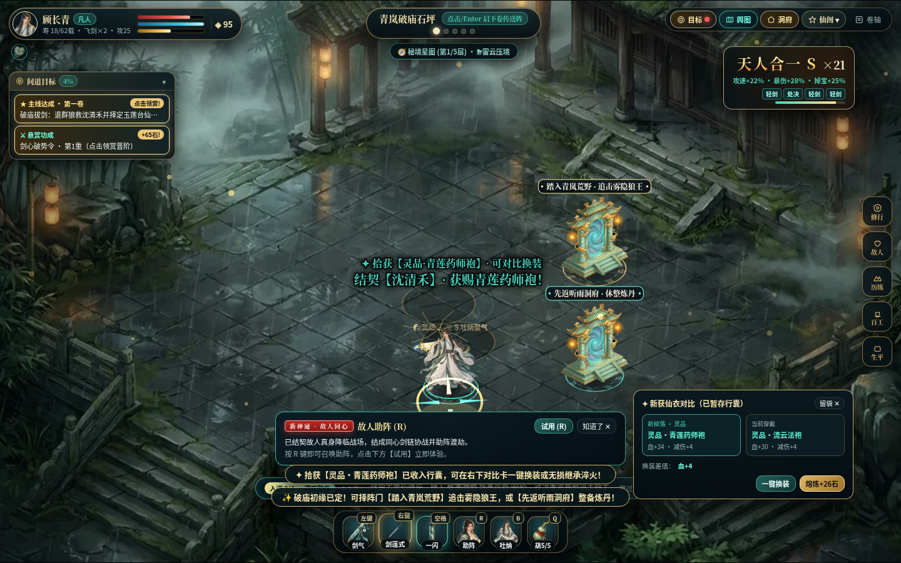

# 《尘缘问道 · 剑阵万象》调研报告与优化方案

> **基线**：`GOD-OF-PPT/chenyaun-v2`，`main` @ `b399c67`（PR #17 合并后的最新提交），调研日期 2026-11-23。
> - 调研时远端只有 `origin/main`，工作树干净。
> - 本报告只记录调研结论与优化方案，**不包含任何游戏代码改动**。
>
> **方法**
> - **实测**：用静态 HTTP 入口打开 `web/public/playable-v2.html`，在 1440×900 Chromium 中跑 5 轮机器人试玩，每轮使用独立的浏览器上下文。机器人真实按键操作，同时用 MutationObserver 记录每一个 toast、弹窗、卡片和头顶横幅。
> - **静态审计**：3 路代码审计，分别负责打断源、界面与美术层次、玩法完整性。
>
> 下文行号均基于 `b399c67`。
>
> 配套文档：[战斗打断源审计（逐条清单）](2026-11-23-combat-interrupt-audit.md)。

---

## 一、问题 1：实时战斗总被提示和选项打断

### 1.1 实测证据

*截图来源：`b399c67` 版本游戏的实机截图（1440×900 Chromium，新开局约第 10 秒），由调研试玩脚本自动抓取，仅作文档插图，不属于游戏美术素材。*

上图是开局第 10 秒的真实画面，同屏同时出现了以下 8 层：
- 头顶 2 条横幅
- 新神通卡
- 2 条 toast，压在新手教练条上面，教练条的文字被遮住
- 右下仙装对比卡
- 右上连击印
- 左上追踪器

其中仙装对比卡上**不可逆的「熔炼+26石」用的是金色主按钮样式**，混战中连点很容易误触。

**开场卷轴关闭后约 6 秒内（序章第一波）的事件时间线**，取自 `progress3` 日志：

| t(s) | 事件 |
|---|---|
| 3.20 | 开场卷轴关闭 |
| 3.31 | 成就 toast ×2（天人交感、一剑破势） |
| 3.85 | 成就 toast（剑符连携） |
| 4.37 | 入道进阶 toast（2/4） |
| 5.03 | 穿戴仙装 toast |
| 5.26 | 沈清禾对白，**暂停** |
| 9.04 | 拾获仙装 toast + 破庙初缘 toast |
| 9.45 | 新神通卡 + 仙装对比卡，两张都常驻并接收鼠标点击 |

**3 分钟持续战斗中的统计**
- 头顶横幅飘字 128–134 条，平均**每 1.3 秒一条**。
- 大部分是普攻连段的招式名，例如「四式·青莲落星斩！」「六象觉醒·【青莲·万剑游龙刺】！！」，玩家每打一套连招就会刷出来。

### 1.2 根因

1. **没有中央的打断管理**
   - 通知走 3 套互不相干的原语：
     - `showToast`（L16467）：279 处调用，**没有优先级、去重和限流**。
     - `addFloat`（L16490）：195 处调用。判定规则是"字号≥15、长度≥5、不以数字开头"就自动升级为头顶横幅，于是"+灵草×2"这类拾取文字也被当成了横幅。
     - `openModal`（L27570）：48 处调用，外加约 25 个包装函数。每次都会设 `arena.paused=true`、抢焦点，并清空玩家正按着的 WASD。
2. **现有的延迟队列不判断"是否还在战斗"**
   - `flushDeferredChoiceModals()`（L16890）和 `flushNewUnlockCard`（L16818）只检查有没有其他弹窗或过场，**不检查场上还有没有敌人**。
   - 因此以下几类会在混战中直接弹出：
     - 背包满（G9，每件装备一个不可关闭的 modal）
     - 魂印抉择（锁妖塔、Boss 连战时）
     - 聚宝金灵三选一（`elemental_vault` 房间里金灵和敌群同时刷出，L19951 / L22397）
     - 大限 modal
     - 天劫后的道果 → 神通 → 2 张新神通卡连环弹窗（L21583→21661→31499）
3. **"暂停"只有一个布尔值**
   - 共有 41 处直接给 `arena.paused` 赋值，没有引用计数。多个弹窗叠加时，暂停可能被提前解除。
4. **实测发现的交互缺陷：Enter 键被 HUD 按钮吞掉**
   - 开场卷轴结束后（点击或按键关闭都一样），焦点落在右上角「卷轴」按钮（`#btn-open-settings`）上。
   - 只用键盘的玩家在玉莲台前按提示上写的 Enter，打开的是**设置面板**，不会和道具交互。关掉设置后焦点又回到「卷轴」按钮，再按 Enter 还是设置，形成死循环。我在两轮试玩里分别复现了 388 次和 500 次。
   - 原因：L29495 的交互逻辑在焦点位于 BUTTON 时让路，让按钮执行原生的 Enter 行为。
   - 这违反了 AGENTS.md「保留键鼠操作、焦点返回」的要求。
5. **没有任何提示密度设置**。`a11ySettings`（L7159）里只有震屏、顿帧等选项。

### 1.3 优化方案：「战斗静默（Combat Calm）」

**判定条件**：直接复用现有的 `isMeditationSafeZone()`（L18839），条件是无存活敌人、不在波次过渡、不在天劫中。在它基础上包一层 `isCombatCalm()`，连续保持 0.8 秒即视为"进入结算时刻"。

| 层级 | 定义 | 战斗中怎么处理 | 何时放行 | 涉及的来源 |
|---|---|---|---|---|
| **P0 立即阻塞** | 生死、数据安全、关键叙事 | 保持现状 | 立即 | 败北抉择 L24185、存档冲突 L16099、Boss 战前过场、卷终演出与回顾卡、结局 |
| **P1 延后到结算** | 需要玩家抉择，但不影响眼下生存 | 只记账。HUD 显示「待处置 N」角标并脉冲，**不暂停、不抢焦点** | 静默 0.8 秒后；或玩家点击角标主动打开 | 背包满、魂印、聚宝金灵（改成可交互的「奇缘玉简」道具）、大限、天劫后的连环弹窗、新神通卡、仙装对比卡（战斗中隐藏） |
| **P2 收进战报** | 纯信息 | 写入 `combatInbox`，角标 +1 | 清场时弹一条汇总：「本波：仙装×3 · 成就×1 · 灵草×7 ▸查看」 | 成就（含 fanfare 音效）、仙装拾取 toast、修为圆满、寿元阈值 |
| **P3 去重或丢弃** | 重复或刷屏 | 同一 key 4 秒内只出一次，或直接删除 | — | 普攻招式名横幅、拾取横幅（改小字号并在 1.5 秒窗口内合并）、蓝不足/未解锁提示、与教练条重复的入道 toast、玩家自己放大招时的切入横幅（只在首次显示） |

**实施落点**（按改动顺序）
1. 新增 `isCombatCalm()`，在 `stepArena`（L22593，放在 paused 判断返回之后）里做边沿检测，并切换 `body.combat-hot` 类。
2. 新增 `flushCombatCalmQueue()`，同时给 `flushDeferredChoiceModals` 和 `flushNewUnlockCard` 加上静默门控；点角标时传 `force` 强制放行。
3. 给 `showToast(msg, {tier, key})` 加可选参数，**只改约 25 个战斗内的调用点**，其余 250 多处旧调用行为不变。给 `addFloat` 加显式的 `banner` 参数。
4. 改造以下几处：
   - `acquireGearItem`：L17031 / L16933
   - `handleEnemyDeath`：L22341 / L22384
   - `completeLiveTribulation`：L21658
5. 防误触：
   - 战斗中按数字键 7、8、9 以及 N、M、T、L 打开窗口时，需要按两次。
   - 「熔炼」按钮改为二次确认，并降为次级按钮样式。
6. **修复 Enter 焦点问题**：卷轴或对白结束后，焦点归还到战场容器，不再落到 HUD 按钮上；靠近道具时，Enter 交互的优先级高于 HUD 按钮。
7. 用 `pauseReasons: Set` 取代对布尔值 `paused` 的直接赋值，降低多个弹窗叠加时的回归风险。
8. 设置面板新增「战斗提示密度」三档：完整 / **精简（默认）** / 极简。
9. 修复附带发现的存档问题：背包满的待处置队列 `pendingGearOverflowQueue`（L16624）**不入存档，刷新后会丢件**。改为延后弹出以后，这个窗口期会变长，所以必须一起持久化，并按 AGENTS.md 覆盖 5 种存档场景。
10. 顺序修正：`enter_*` 和 `boss_pre_*` 过场目前是先刷怪再播对白，改为在 `onFinish` 回调里再刷怪。

**验收**
- 背包 24/24 时在混战中连续拾取 3 件：期望不暂停、角标显示 3，清场 0.8 秒后依次弹出，焦点能正确返回。
- 刷新后待处置的装备不丢失。
- 存档冲突仍然立即弹出。
- 只用键盘时，Enter 能正常和道具交互。

> 详细的来源清单（A1–A14、B1–B5、C1–C17，含行号和 41 处 paused 写入点）见 [战斗打断源审计](2026-11-23-combat-interrupt-audit.md)。

---

## 二、问题 2：支线很多，但交互和美术缺乏层次感

### 2.1 现状

**信息架构：主线、支线、系统在界面上平铺，没有分层**
- 支线入口散在 5 个地方：
  - 仙阁下拉菜单（L3495–3519）：11 项，**锁妖塔、万剑冢、登仙台和 BGM/SFX 开关、F3 遥测、拍照放在同一级**。
  - 洞府底栏（L3841–3890）：20 个胶囊按钮，其中登仙台和万剑冢与仙阁菜单重复。
  - 舆图标题栏的内联按钮。
  - 右侧抽屉的 5 个页签。修行页签里有 11 张同样样式的卡片，看不出主次。
  - 约 35 个快捷键。
- HUD 上可见的按钮数：凡人 16、炼气 28、筑基 35、金丹及以后 36。后期从 HUD 一层能点到的按钮约 77 个。
- 唯一做了分层的是左上追踪器：主线金、悬赏青、故人粉（CSS L791–795）。
- 舆图只有 8 个节点，**没有连线，不区分主线和支线**，第五卷没有节点。

**设计系统：缺少 token**
- `:root` 只定义了 16 个变量，`--violet`、`--amber` 一次都没用过。
- CSS 中有 184 种 hex 颜色、582 种 rgba，内联 `style=` 约 1,182 处。
- 字号 27 种，大量是 9.5、9.8、10.8 这样的半像素，信息挤在 9–12px 之间。
- z-index 有 34 种取值，按版本临时插入。
- 44 个选择器被重复定义（例如 `#action-skill-dock` 定义了 5 次），`!important` 共 180 处。
- 类名直接带版本号：`v22-tac-btn`、`v23-ep-btn`、`v24-gen-btn`。
- 弹窗和抽屉开关没有进出场动效，全游戏只有 2 个 `@keyframes`。

**美术：素材质量高，但只有一层**
- 每关只有一张静态背景图（`#stage-bg-img`），随玩家做 ±14px 视差。canvas 在上面叠光线、天气和粒子，但**没有中景，也没有画在角色前面的遮挡层**。
- 11 张 `scene_*` 场景图里有 **10 张只做了预加载，从没用上**。这是现成的分卷中景素材。
- 背景复用：
  - 锁妖塔和第四卷共用 `arena_tower`。
  - 万剑冢、烛龙巨像、造化工坊共用一张图。
  - 护山战直接进洞府场景。
- 9 种普通敌人贯穿全部章节。
- 战斗内的打击反馈很强（顿帧、震屏、冲击帧、斩杀印），但游戏外层的反馈很弱：切换模式时直接换掉背景图，没有转场。

### 2.2 优化方案

**(a) 信息架构：三层结构 +「九州问道卷轴」中枢**
- **P0｜卷轴中枢**
  - 把舆图（M）和目标（T）合并成一个全屏卷轴，在 `openWorldMapModal`（L21714）的基础上扩展，分 3 个页签：
    - **主线 · 卷**：6 卷 18 步用朱砂连线串起来，已完成的盖金印，当前节点有脉动效果，未开放的显示为墨灰剪影。
    - **支线 · 试炼**：锁妖塔、万剑冢、登仙台等作为岔路节点，挂在对应卷的旁边，用圆印区别于主线的方印。未解锁的节点显示所需境界。
    - **故人线**。
  - 给 `KYUSHU_MAP_NODES`（L5713）加 `tier` 和 `links` 字段。
  - 只有玩家点击「前往」才会进入，符合「玩家主动选择才推进」的规约。
- **P0｜仙阁只保留工具**：拍照、遥测、音频、沙盒、轮回殿。玩法入口全部迁到卷轴的支线页签；洞府底栏的「诸天试炼」收成一个按钮。
- **P1｜右侧抽屉收敛为 3 个页签**：修行、百工、生平。故人和历练并入卷轴。修行页签按「核心 / 进阶 / 收藏」分三段，后两段默认折叠。
  - 注意：`#nav-btn-story` 被测试引用，迁移时保留它作为跳转入口。
- **P1｜HUD 按三级常驻**：后期常驻按钮从 36 个降到 22 个以内，凡人阶段仍保持 ≤14 个（P3-1 的约束）。

**(b) 设计 token 与三级强调**
- 在 `:root` 补齐以下 token：
  - **语义色**：`--c-main` 主线（金/朱砂）、`--c-side` 试炼（紫，启用闲置的 violet）、`--c-econ` 经济（琥珀）、`--c-system` 系统（青玉）、`--c-companion` 故人（粉）、`--c-danger` 危险。
  - **字号 6 档**：11 / 12 / 13 / 15 / 18 / 24，取消所有半像素字号。
  - **间距 6 档**、**圆角 4 档**、**海拔 4 档**（阴影和模糊一起定义，模糊只保留 0 / 6 / 12px 三档）。
  - **z-index 收敛为 8 层**：bg / world / hud / panel / overlay / cinematic / modal / toast。
- 按钮分三级：`.btn-primary`（每屏最多 1 个）、`.btn-secondary`、`.btn-tertiary`。由现有的 gold / jade / ghost 改名而来，旧类名保留为别名。再加 `.is-side`、`.is-locked` 两个修饰类。
- 统一弹窗外壳：`modal__header / body / footer`，加 `data-tier` 后标题色条跟随层级变色。进出场动效 180ms，遵守 `prefers-reduced-motion`，保留 Esc 关闭和焦点返回。

**(c) 美术：每卷远、中、近三层 + 分卷调色**
- **远景**：现有的 `arena_*`，视差系数 0.3。
- **中景**：启用那 10 张闲置的 `scene_*`，视差系数 0.6。
- **近景**：在 `renderArenaCanvas` 的 Y 排序角色之后、天气之前（L25756–L26613 之间）画遮挡物，如枝叶、檐角、锁链、云絮，视差系数 1.2。
- **分卷调色**：给 `CAMPAIGN_ACTS`（L4837）加 `grade` 字段。
  - 卷一：青绿晨雾
  - 卷二：暖金宗门
  - 卷三：幽蓝秘境
  - 卷四：赤铁塔狱
  - 卷五：紫雷劫云
  - 卷六：白金天门
- **支线辨识度**：锁妖塔用冷紫调色加锁链前景，和第四卷区分开；万剑冢、巨像、造化工坊分别做剑林、熔金、齿轮效果；护山战用夜色加妖雾。
- 9 种普通敌人按卷做色调和描边变体，成本很低。
- 新增或改动的美术，一律在 `docs/art-manifest.md` 登记来源、许可、SHA-256 校验值和使用位置，并保留制作素材。

**(d) 支线视觉编码：颜色、形状、印章三者统一**

| 层 | 色 | 形状 / 印章 | 用在哪里 |
|---|---|---|---|
| 主线 | 金 + 朱砂 | 方印、实线 | 罗盘、卷轴主线、追踪器第一行、primary 按钮 |
| 故人线 | 粉 | 心印 | 追踪器、卷轴、对白框边 |
| 试炼 | 紫 | 圆印、虚线岔路 | 锁妖塔、万剑冢、登仙台、云海、烛龙 |
| 经济 | 琥珀 | 六角印 | 百工、造化、丹剑、远征 |
| 系统 | 青玉 / 灰 | 无印 | 仙阁工具、设置 |

**补充**
- 进入支线时，播放一段对应颜色的水墨晕染转场，约 400ms，挂在 `showRegionCinemaCard`（L6066）上。
- 新神通卡增加「在卷轴中查看」按钮，点击后高亮对应节点，但不自动进入。

---

## 三、问题 3：与「玩法完整清晰的游戏」的差距

### 3.1 一句话结论

游戏能从头到尾打通，内容量也很大，但**没有一句话就能说清的核心循环**：
- 真正卡主线的系统只有约 5 个：基础战斗、闭关、渡劫、5 个卷首 Boss。
- 同时有 40 多个系统、20 多种资源、约 40 个按键平铺在玩家面前。
- V11 到 V24 每个版本都在往上叠功能，叠完没有做过整合。
- M3–M6 的 23 项改动**完全没有做过动态验证**。

### 3.2 差距矩阵

| 维度 | 现状（证据） | 目标 | 严重度 |
|---|---|---|---|
| 核心循环 | 修为靠洞府闭关，约 78 秒补满一个境界（L22811）；有「无丹逆天强渡」，丹药不是必需（L21380+）；CHAPTERS 18 步里，灵宠、法宝、法则、故人这几步**都不是门槛** | 一句话循环：斩妖 → 材料/修为 → 炼丹/强化 → 破境 → 斩卷首，每个环节都必要 | **P0** |
| 输入复杂度 | 约 40 个键；大招级按键 12 个；6 套叠在一起的攻击风格（三才、双姿态、剑匣、剑谱、换人、流派）；B 键、Q 键的说明文字和实际行为不一致（L8739 / 8740 / 21371） | 战斗核心 ≤10 个键，大招 ≤3 个可装配槽位 | **P0** |
| 无门槛的数值开关 | `]` 双人 AI 队友、`\` 天时加成（最高攻击 +22%），凡人期就能用（L29463–29465、L12057） | 移入沙盒或设置，或纳入解锁节奏 | **P0** |
| 测试与 CI | **CI 从 PR #13 起每次都是红的**（已实测：`art:manifest:check` 报 out of date，回归测试从没在 CI 里跑到过）；回归套件 31 个中 12 个失败（审计时逐个套件 `--filter` 实测），其中 R2-2 是模态框焦点陷阱回归，另有 6 个原因未知；`tests/e2e` 不存在；R3–R6 的套件一个也没写 | 全绿，补齐 R3–R6 和 E2E Tier 1–4 | **P0** |
| 焦点 / 键鼠 | 实测 Enter 被「卷轴」按钮吞掉，进入死循环；R2-2、R2-6 失败 | 满足 AGENTS.md 的焦点返回要求 | **P0** |
| 资源与货币 | 20 多种。**轮回道果点只增不减，没有任何消耗途径**（L17320 / 17941 / 18079）；道心三维和因果重复；天象和天时重复；评级体系有 7 套 | 6–8 种资源，每种来源和用途明确；评级只保留关卡三星和结局评级 | P1 |
| 卷结构 | 6 卷只有 5 个关卡；**第五卷没有新 Boss 门槛**（`REALM_BOSS_GATE.nascent=3` 复用了古境剑傀，L5589）；终局 Boss 在元婴期就能挑战 | 6 卷 6 关，每卷一个新门槛 | P1 |
| 必做 / 可选 | 追踪器按顺序显示，会一直停在非必需的步骤上（L18263） | 标出「必做 / 可选」，可选步骤可以跳过 | P1 |
| 难度曲线 | 战役 Boss 血量固定（3.6k→45k），侧边模式却随境界缩放；攻击力来源约 25 项；G3 设定的「45–90 秒击杀」目标没有任何测试验证 | 每关有目标击杀时间表，并有自动化断言 | P1 |
| 新手引导 | 引导只有 4 步，到炼气期就结束；筑基一次解锁 6 个键；P3-1 失败（开场卷轴把引导条遮住了） | 每次突破最多新增 2 个键，并配演武坪专项练习 | P1 |
| 侧边模式 | 演武入口 20 个，和主线的产出没有关联 | 分为主线内嵌 / 终局 / 玩具三类 | P1 |
| 文档 | 只有营销风格的更新志，没有设计文档 | 一页 GDD，写明核心循环、系统地图、数值表 | P1 |
| 可维护性 | 单文件 8.24 MB；`renderArenaCanvas` 约 1.9k 行；8 个调试全局变量；还有零引用的函数 | 按模块拆源码，再构建成单文件；统一调试钩子 | P2 |

### 3.3 路线图

| 阶段 | 主要内容 | 建议分支 / PR |
|---|---|---|
| **0 止血** | ① art-manifest 改为按 key 记录使用位置，不再依赖行号，让 CI 能真正跑到回归测试；② 回归脚本改为失败后继续跑完并汇总；③ 适配 PROJECT.md 里已经预知的 5 个失败，在共享辅助函数里统一跳过开场卷轴，再复测 6 个原因未知的失败；④ 修复 R2-2 焦点陷阱和 Enter 焦点死循环；⑤ 编写 R3–R6 冒烟套件 | `codex/ci-test-debt` |
| **1 战斗静默** | 第一节方案的全部内容（含背包满队列持久化及 5 种存档场景验证） | `codex/combat-calm` |
| **2 核心循环** | 写 `docs/design.md`；修为主要来自战斗，闭关收益递减；拉开「无丹强渡」与正常渡劫的难度和代价差距；每个侧边模式只产出一种核心资源 | `codex/core-loop` |
| **3 删减合并** | 三才、双姿态、剑匣、剑谱合并为「剑形态」；4 / 5 / 6 / O / J / U 改为「化神绝技」，三选一装进槽位；R 和 G 合并；`]` `[` `\` 移进沙盒；轮回道果点增加消耗途径或删除；合并评级体系 | `codex/system-consolidation` |
| **4 层次感** | 第二节方案：token → 统一弹窗 → 卷轴中枢 → 入口迁移 → 三层场景与调色 → 支线辨识度 | `codex/ui-tokens`、`codex/scroll-hub`、`codex/art-layers` |
| **5 关卡与难度** | 补第五卷专属关卡和 Boss（可以用 sky_roc 或云海空战）；终局 Boss 要求化神；写离线数值模拟，输出击杀时间表并加回归断言 | `codex/volume5-balance` |
| **6 可维护性** | 拆成 `src/` 模块，构建出单文件，入口不变；调试钩子统一为 `__CHENYUAN_DEBUG__`；更新志改成 CHANGELOG | `codex/modular-build` |

> [!IMPORTANT]
> **阶段 0 必须最先做。** CI 目前一直是红的，M3–M6 也没有动态回归，后面任何改动都无法证明没有引入新问题。按 AGENTS.md「保留真实验证结果」，每个 PR 都应附上真实的回归结果。

---

## 四、待确认的设计取舍

1. **主线是否要强制使用炼丹、灵宠等系统？** 也就是阶段 2 是否收紧循环。还是保持现在"可选加成"的轻度设计，只在界面上把"必做 / 可选"标清楚？
2. **系统删减的力度**：阶段 3 会合并或下线一批按键和玩法（例如一气化三清、山河社稷图、仙舟改为三选一的槽位，双人和天时移进沙盒）。这些功能可以接受被收进沙盒或二周目吗？
3. **战役难度是否随境界缩放**：保持现在"战役固定、侧边模式缩放"的做法，还是统一缩放？
4. **执行顺序**：建议按阶段 0 → 1 → 4 推进，先解决 CI、战斗打断和层次感这几个体验最明显的问题，阶段 2、3 等确认取舍后再动。

---

### 附：实测数据与验证范围（真实结果，未经修饰）

| 轮次 | 时长 | 起点 | 主要记录 |
|---|---|---|---|
| fresh | 180s | 新开局（凡人） | 头顶横幅 134 条、toast 9 条、对白暂停 2 次；机器人只用键盘，被 Enter 焦点问题卡在序章 |
| golden | 180s | 新开局后注入金丹境 | 头顶横幅 128 条、toast 9 条 |
| progress | 300s | 新开局 | Enter 打开设置面板 388 次（焦点停在 `#btn-open-settings`） |
| progress2 | 360s | 新开局 | 同上，500 次 |
| progress3 | 300s | 新开局，交互前先用鼠标点击战场 | 推进到第一卷秘境第 2 层星图；开场后约 6 秒内出现 11 个提示事件 |

- 环境：`python3 -m http.server` 静态入口，Playwright（playwright-core 1.65.1）+ Chromium，1440×900，每轮使用独立的浏览器上下文。
- 全部试玩 **0 个控制台或页面错误**。
- 焦点探针：用点击或 Space 关闭开场卷轴后，`document.activeElement` 均为 `BUTTON#btn-open-settings`；鼠标点击战场后变为 `BODY`。
- 覆盖范围限制：机器人只推进到第一卷秘境星图，没有学会在星图中选节点。所以后期的打断（背包满、天劫连环弹窗等）结论来自静态代码审计，没有实测覆盖。
- CI 状态（`gh run list`）和 `npm run art:manifest:check` 失败（docs/art-manifest.md is out of date）已直接复核；回归套件 19/31 通过的结果来自代码审计时逐个套件 `--filter` 运行，没有整套复跑。
- 试玩脚本属于一次性调研工具，没有提交到仓库；如需复现，可在阶段 0 中整理进 `tests/` 目录。

